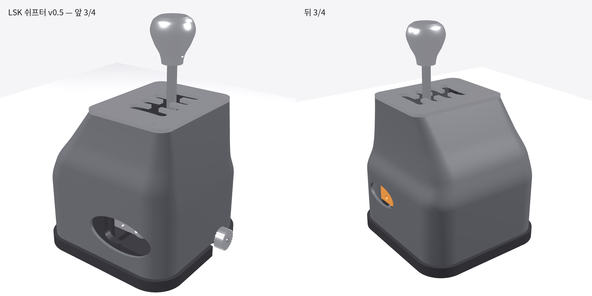

# Racing Sim — DIY 심레이싱 장비

페달 · 핸들 · 기어 쉬프터를 직접 설계하고 만드는 개인 프로젝트. 하드웨어·펌웨어·소프트웨어 모두 자체 제작.

제작: **Sunggwan**



| 모듈 | 상태 | 폴더 |
|---|---|---|
| 기어 쉬프터 — LSK H/SEQ Shifter | 🟢 설계 v0.5 완료 · 실물 제작 전 | [`shifter/`](shifter/) |
| 페달 | ⚪ 미착수 | [`pedals/`](pedals/) |
| 핸들 | ⚪ 미착수 | [`wheel/`](wheel/) |

- **진행 상황 (지난·현재·앞으로)**: [`PROGRESS.md`](PROGRESS.md)
- 대화 간 이어가기용 설계 로그: [`docs/RACING_SIM_DESIGN.md`](docs/RACING_SIM_DESIGN.md)

## 레포 구조
```
PROGRESS.md            진행 상황 (매 작업마다 갱신)
docs/                  프로젝트 공통 문서
shifter/
  CAD/v0.X/            버전별 산출물: mach/sheet · mach/block · print · buy · assembly
  src/                 파라메트릭 CAD·도면 소스 (build123d) + 버전별 아카이브
  firmware/            RP2040 펌웨어 (PlatformIO) + 빌드된 UF2
  docs/                설계 문서 (현재 + 이력)
  docs/dxf/v0.X/       가공 도면 (DXF·PDF + YAML 원본: 치수·공차·기하공차·후처리)
  images/              렌더, 손맛 곡선, 배선도
pedals/  wheel/        다음 모듈 (예정)
```
