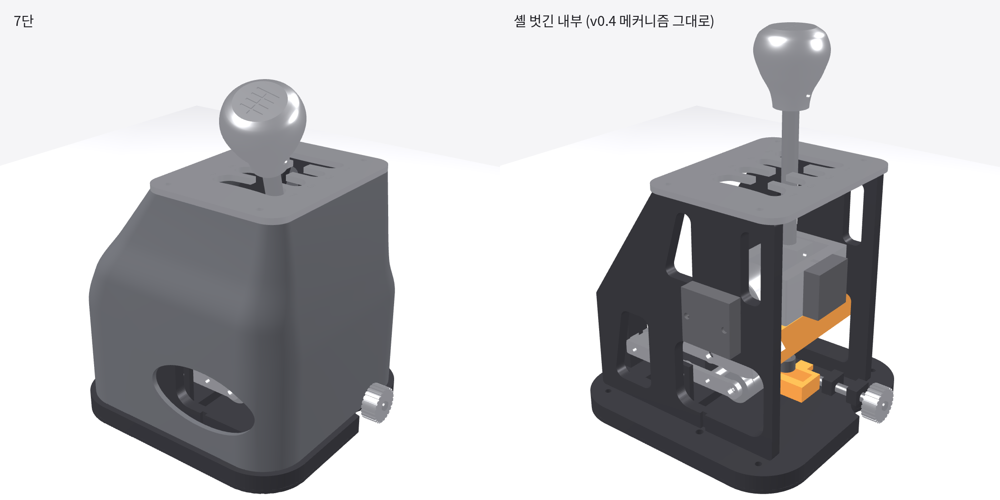
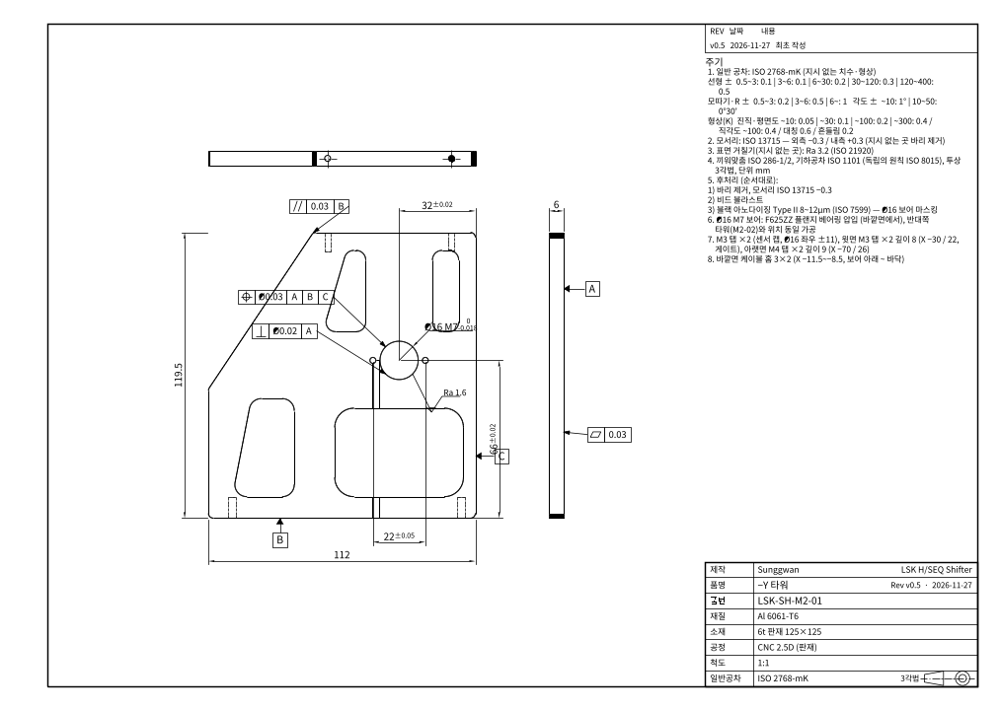

# LSK H/SEQ Shifter (v0.5)

7단+R H패턴(표준·도그레그) + 시퀀셜 겸용 쉬프터. 제작: **Sunggwan**

- 크기 133 × 127 × 199mm, 부품 예상가 약 11만원 (6061 직접 CNC 기준)
- 롤러-캠 디텐트: 싱크로 고개 약 20N → 빨려 들어감 → 14° 금속 스톱 / 시퀀셜은 같은 캠 ±8° + 잠금 포켓
- RP2040-Zero + MT6701 14비트 ×2, USB HID ("Sunggwan / LSK HSEQ Shifter")



## 폴더
| 폴더 | 내용 |
|---|---|
| [`CAD/`](CAD/) | **버전별 산출물** `v0.1`~`v0.5` — 각 버전 안에 `mach/sheet`(판재 가공) · `mach/block`(블록 가공) · `print`(출력) · `buy`(구매품) · `assembly`(조립) |
| `src/` | 파라메트릭 소스: `cam.py`(손맛 곡선 → 캠), `cad.py`(전 부품), `check.py`(간섭 검사), `export.py`, `make_drawings.py` + `drawings.py`(도면), `iso_tol.py`(ISO 286 공차), `render_pbr.py`, `feel_chart.py`, `BOM.csv` / `archive/` v0.1~v0.4 소스 |
| `firmware/` | PlatformIO 프로젝트, `bin/*.uf2` 바로 굽기용 — [FIRMWARE.md](firmware/FIRMWARE.md) |
| `docs/` | `DESIGN_v0.5.md`(외장), `DESIGN_mechanism_v0.4.md`(메커니즘·가공·조립·튜닝), `history/` |
| [`docs/dxf/`](docs/dxf/) | **가공 도면** 버전별 (DXF·PDF·PNG + YAML 원본) — 치수·끼워맞춤·기하공차·후처리, ISO 2768-mK — [v0.5 목록](docs/dxf/v0.5/INDEX.md) |
| `images/` | 렌더, 손맛 곡선, 배선도 |

## 모듈
| 코드 | 이름 | 제작 |
|---|---|---|
| M1 | 베이스·전자부 (RP2040 포켓) | 6061 8t CNC + 출력 커버 |
| M2 | 타워 ×2 | 6061 6t CNC |
| M3 | 짐벌 코어 (크래들·허브·레버·중공 핀) | 6061 CNC + 구매 |
| M4 | 좌우 스프링 카트리지 | ABS 출력 |
| M5 | 디텐트 카세트 (캠·암·625×3·금형 스프링) | 6061 CNC |
| M6 | SEQ 잠금 (암·편심·모드 노브) | CNC + 출력 |
| M7 | 게이트 (기어 번호 각인) | 6061 3t CNC |
| M8 | 노브 (물방울형) | 출력 / CNC |
| M9 | 센서 캡 ×2 + 핀 칼라 | 출력 |
| M10 | 외장 셸 (곡면) | ABS 출력 |

## CAD·도면 다시 생성하기
```bash
pip install -r src/requirements.txt
cd src
python3 cam.py           # 손맛 곡선 시뮬레이션
python3 check.py         # 간섭 검사 (41개 자세)
python3 export.py        # → ../CAD/v0.5/ (mach/sheet, mach/block, print, buy, assembly)
python3 make_drawings.py # → ../docs/dxf/v0.5/ (YAML → DXF·PDF·PNG)
```


