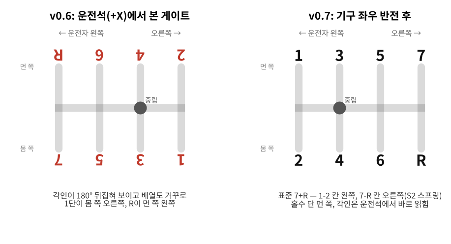
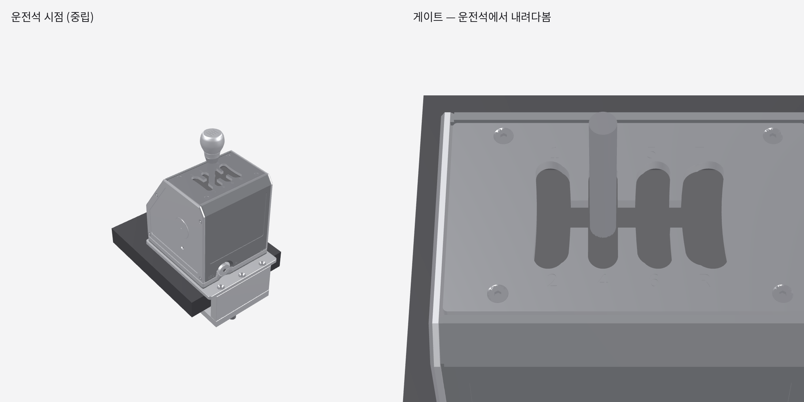
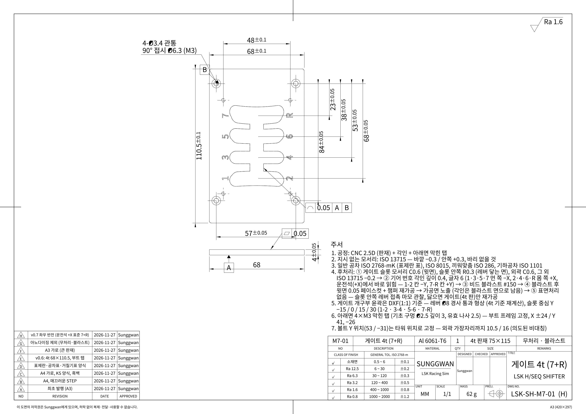

# LSK H/SEQ Shifter (v0.7)

7단+R H패턴(표준·도그레그) + 시퀀셜 겸용 쉬프터. 제작: **Sunggwan**

- 크기 130 × 118.5 × 202mm, 부품 예상가 본체 약 14.26만원 + 책상 클램프 1.5만원 (6061 직접 CNC, 판재는 평균가 추정 — 배송비·공구 제외, 필라멘트 보유 재고, 아노다이징 안 함)
- v0.7: v0.6 전체를 **좌우 반전** → 운전석(+X, 모드 노브 면)에서 표준 7+R, 틈 보완 4건 — [DESIGN_v0.7.md](docs/DESIGN_v0.7.md)
- 외장(v0.6): 6061 사이드 패널 + 출력 커버 + 4t 게이트 샌드위치, 섀도우 갭 1mm, 무처리 알루미늄(블라스트) + 출력 커버 투톤, 데스커 책상 클램프(M12) — [history/DESIGN_v0.6.md](docs/history/DESIGN_v0.6.md)
- 롤러-캠 디텐트: 싱크로 고개 약 20N → 빨려 들어감 → 14° 금속 스톱 / 시퀀셜은 같은 캠 ±8° + 잠금 포켓
- RP2040-Zero + MT6701 14비트 ×2, USB HID 1000 Hz + 설정용 시리얼 ("Sunggwan / LSK HSEQ Shifter"), 설정은 CLI 또는 웹





## 폴더
| 폴더 | 내용 |
|---|---|
| [`CAD/`](CAD/) | **버전별 산출물** `v0.1`~`v0.7` — 각 버전 안에 `mach/sheet`(판재 가공) · `mach/block`(블록 가공) · `print`(출력) · `buy`(구매품) · `assembly`(조립) |
| `src/` | 파라메트릭 소스: `cam.py`(손맛 곡선 → 캠), `cad_model.py`(전 부품, 반전 전 모델 좌표) + `cad.py`(Y 반전한 최종 좌표 — 바깥 스크립트는 이것만), `check.py`(간섭 검사, 1 mm³ 이하 경고), `review_fusion.py`(운전석 렌더·1° 움직임 스윕), `mirror_specs.py`(도면 YAML 반전), `export.py`, `make_drawings.py` + `drawings.py`(A4/A3 도면, STEP 은선 처리), `smooth2d.py`(매끄러운 2D 경계), `iso_tol.py`(ISO 286 공차), `render_pbr.py`, `feel_chart.py`, `render_v06.py`(v0.6 렌더), `boot_pattern.py`(부트 재단 패턴), `BOM.csv` / `archive/` v0.1~v0.6 소스 |
| `firmware/` | 펌웨어 0.6 (PlatformIO), `bin/*.uf2` 바로 굽기용 — [FIRMWARE.md](firmware/FIRMWARE.md) |
| `tools/` | 설정 도구: `lsk_shifter.py` (CLI), `web/index.html` (WebSerial, Chrome/Edge), `test_cli.py` (시뮬레이터 종단 시험) |
| `docs/` | `DESIGN_v0.7.md`(v0.6에서 바뀐 점), `history/DESIGN_v0.6.md`(외장), `DESIGN_mechanism_v0.4.md`(메커니즘·가공·조립·튜닝), `history/` |
| [`docs/dxf/`](docs/dxf/) | **가공 도면** 버전별 (DXF·PDF·PNG + YAML 원본) — 치수·끼워맞춤·기하공차·후처리, ISO 2768-mK — [v0.7 목록](docs/dxf/v0.7/INDEX.md) (18장) · [v0.6 목록](docs/dxf/v0.6/INDEX.md) · [v0.5 목록](docs/dxf/v0.5/INDEX.md) |
| `images/` | 렌더, 손맛 곡선, 배선도 |

## 모듈
| 코드 | 이름 | 제작 |
|---|---|---|
| M1 | 베이스·전자부 (RP2040 포켓) | 6061 8t CNC + 출력 커버 |
| M2 | 타워 ×2 | 6061 6t CNC |
| M3 | 짐벌 코어 (크래들·허브·레버·중공 핀) | 6061 CNC + 구매 |
| M4 | 좌우 스프링 카트리지 | ABS 출력 |
| M5 | 디텐트 카세트 (캠·암·625×3·금형 스프링) | 6061 CNC |
| M6 | SEQ 잠금 (암·편심·모드 노브) | CNC + 출력 |
| M7 | 게이트 (기어 번호 각인, 접시머리 노출) | 6061 4t CNC |
| M8 | 노브 (슬림 티어드롭, M12×1.25) + Ø12 슬리브 + 테이퍼 록너트 | 출력 / CNC |
| M9 | 센서 캡 ×2 + 핀 칼라 | 출력 |
| M10 | 외장: 사이드 패널 ×2 + 앞·뒤 커버 + 스모크 창 | 6061 3t CNC + ABS/PETG 출력 |
| M11 | 내부 방진 부트 (프레임 + 레버 칼라 + 천) | 출력 + 구매 |
| M12 | 데스커 책상 클램프 (윗판·기둥·아래 턱 + 누름 패드·손잡이 + M10) | 6061 CNC + 출력 + 구매 |

## CAD·도면 다시 생성하기
```bash
pip install -r src/requirements.txt
cd src
python3 cam.py           # 손맛 곡선 시뮬레이션
python3 check.py         # 간섭 검사 (41개 자세 + 책상 두께 3종)
python3 review_fusion.py sweep   # 1° 간격 움직임 스윕 → 최소 틈 (선택)
python3 export.py        # → ../CAD/v0.7/ (mach/sheet, mach/block, print, buy, assembly)
python3 fusion_pack.py   # → ../CAD/v0.7/fusion/ (Fusion용 조립 STEP·PARAMS)
python3 make_drawings.py --version v0.7 # → ../docs/dxf/v0.7/ (STEP + YAML → A4/A3 DXF·PDF·PNG)
```


