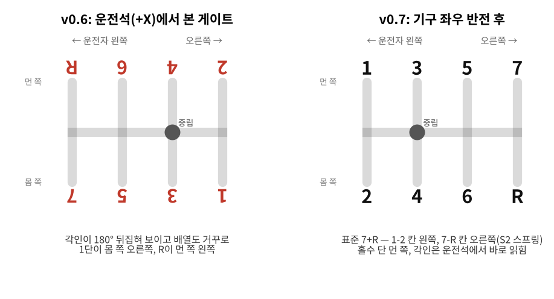

# LSK H/SEQ 쉬프터 v0.7 — 좌우 반전 + Fusion 검토 보완 (제작: Sunggwan)

v0.6 외장·기구를 그대로 두고 **전체를 좌우(Y)로 반전**했습니다. 그래서 운전석(+X, 모드 노브 면)에서 보면 이제 **표준 7+R**이에요.
Fusion 검토(11-27)에서 찾은 **틈 부족 4건**도 같이 고쳤어요.
크기(130 × 118.5 × 202mm)와 손맛 기구(피벗, 레버 110/55, 캠, 롤러·스프링, 게이트 간격 15)는 v0.6과 같고, 위치만 거울상이에요.
외장 디자인은 [`history/DESIGN_v0.6.md`](history/DESIGN_v0.6.md), 내부 기구는 [`DESIGN_mechanism_v0.4.md`](DESIGN_mechanism_v0.4.md)를 보세요. 이 문서는 v0.6에서 바뀐 것만 적습니다.

## 1. 왜 반전했나
- v0.1부터 기구, 게이트 각인, 펌웨어는 **"+X = 차 앞(운전자에서 먼 쪽), +Y = 운전자 왼쪽"**을 기준으로 만들었어요. 운전자는 −X에 앉는다는 전제예요.
- 그런데 v0.6 책상 클램프에서 **모드 노브 면(+X)을 운전석 쪽**으로 정했어요. 그 결과 운전석에서 보면 H 패턴이 180° 돌아가 있었어요.
  - 1단이 몸 쪽 오른쪽, R이 먼 쪽 왼쪽에 오고, 숫자도 거꾸로 읽혔어요.
  - S2 스프링이 걸리는 바깥 칸(7-R)이 운전자 **왼쪽**에 있어서, 각인만 바꿔서는 표준 7+R을 만들 수 없었어요.
- 사용자 결정 (11-27): **기구 좌우 반전**. 다른 안이었던 "180° 돌려 놓기"와 "도그레그 각인"은 고르지 않았어요.

## 2. 최종 좌표 (v0.7 산출물 전부)
- 원점은 짐벌 피벗, 단위는 mm·°예요.
- **+X = 운전석 쪽**(모드 노브 면, 책상 앞 모서리), −X = 먼 쪽(USB-C), +Z = 위.
- **−Y = 운전자 왼쪽**: 1-2 칸, S2 예압 렌치 구멍 패널, 모드 노브 축, 배선 중공 핀이 이쪽에 있어요.
- **+Y = 운전자 오른쪽**: 7-R 칸, 캠·롤러, 피치 센서 캡, 작은 창이 이쪽에 있어요. 몸체 외곽은 Y −51 ~ 67.5예요(v0.6의 거울상).
- 게이트 좌우 각도 φ는 **1-2 −15.26° · 3-4 0° · 5-6 +15.26° · 7-R +28.61°**예요(v0.6과 부호 반대).
- 앞뒤 θ는 +일 때 레버 윗끝이 +X(몸 쪽)로 가요. 홀수 단은 θ −14°(먼 쪽), 짝수 단과 R은 θ +14°(몸 쪽)예요.
- 베이스 아래 M6 탭(40mm 간격)은 **(−60, 40) (−20, 40) (−20, −20) (20, −20)**이에요. 클램프 윗판도 같이 반전돼서 맞아요.

### 소스 구조 (`shifter/src/`)
| 파일 | 역할 |
|---|---|
| `cad_model.py` | v0.6까지의 소스 그대로예요(**반전 전 "모델 좌표"**). 글자 각인만 미리 뒤집어 둬서 반전 후에 바로 읽혀요 (`_txt_premirror`). |
| `cad.py` | 모델 형상을 XZ 평면 기준으로 반전해요(Y → −Y). −Y/+Y 이름(타워, 패널, S1 플런저 L/R)도 바꿔 붙이고, `PHI = −PHI_M`으로 바꿔요. **바깥 스크립트는 전부 이 파일만 써요.** |
| `mirror_specs.py` | v0.6 도면 YAML을 v0.7로 바꿔요. y 좌표 부호를 바꾸고, top/right 뷰 지시선을 뒤집고, −Y/+Y 쌍을 맞바꾸고, rev를 올려요. |
| `review_fusion.py` | 운전석 시점 렌더, 기어별 자세 렌더, 1° 간격 움직임 스윕과 최소 틈을 만들어요. |

주의: `cad_model.py`의 Y 상수(`YC`, `SHAFT_Y`, `GATE_Y`, `Y_NEG_OUT` …)는 반전 전 값이에요. 최종 좌표에서는 부호를 바꿔서 읽으세요.

## 3. 바뀐 것 (v0.6 → v0.7)
### 3.1 좌우 반전으로 바뀐 것 (형상은 거울상, 치수 같음)
| 항목 | v0.6 | v0.7 |
|---|---|---|
| H 패턴 (운전석에서) | 180° 돌아감 (1단 몸 쪽 오른쪽) | **표준 7+R**: 1·3·5·7 먼 쪽, 2·4·6·R 몸 쪽, 1-2 왼쪽, 7-R 오른쪽 |
| 게이트 각인 | −X 쪽에서 읽힘 | **운전석(+X)에서 바로 읽힘** (`images/gate_engraving_driver_view.png`) |
| 작은 창 (스모크 아크릴) | −Y (운전자 쪽) | **+Y** (운전자 반대쪽). 반전을 고를 때 받아들인 변경 |
| S2(7·R) 예압 렌치 구멍 | +Y | **−Y** (운전자 쪽이라 조정이 쉬워짐) |
| M10-01 / M10-02 사이드 패널 | −Y 창 / +Y 렌치 구멍 | **−Y 렌치 구멍 / +Y 창** (도면도 맞바꿈) |
| 피치 센서 캡(M9-01) / 배선 중공 핀(M3-05·M9-03) | −Y / +Y | **+Y / −Y** (타워 M2-01·M2-02 형상이 서로 맞바뀜) |
| 모드 노브 · H/SEQ 각인 | 노브 y +13.3 | 노브 **y −13.3** (앞면 가운데에서 운전자 왼쪽), 각인은 바로 읽힘 |
| S1 스프링 자유장 | −Y 24 / +Y 30 | **−Y 30 / +Y 24** (S2 27 그대로), BOM 비고 갱신 |
| 출력 방향 (STL) | — | 이름이 안 바뀌는 부품(M4-04·05, M9-01·03, M10-03·04)의 X축 ±90° 출력 회전 부호를 바꿈 → 같은 면이 베드에 닿음 |

펌웨어는 고칠 것이 없어요. 펌웨어 φ +는 "운전자 왼쪽 = 1-2 칸"이고 θ +는 "1단 쪽"인데, 둘 다 운전석 기준이라 이제 실물과 맞아요.
부호(`k_p`, `k_r`)는 캘리브레이션 때 1단(1-2 칸)에서 자동으로 정해져요(`proto.h`).
도그레그 맵(R-1 | 2-3 | 4-5 | 6-7)도 왼쪽 칸이 R·1이라 실제 도그레그와 같아요.

### 3.2 검토에서 찾아 고친 틈 (출력 부품은 1.2, 금속은 1.0 규칙)
기존 `check.py`는 1 mm³보다 작은 겹침을 지나쳤어요. 이번에 1° 간격 스윕(146 자세, `review_fusion.py sweep`)으로 찾았어요.

| 부품 | 문제 (v0.6) | 수정 | 결과 |
|---|---|---|---|
| M4-01 카트리지 ↔ M3-06 꼬리 볼트 | 7-R(모든 θ)에서 슬롯 끝 바닥 턱에 **0.12mm 겹침** (0.01 mm³). 출력 턱이 7-R 스톱 노릇을 함 | S2 포켓 아래 바닥 턱을 터 줌 (폭 11, 길이 3.5, 깊이 0.8) | 틈 1.1 (슬롯 옆면 설계값) |
| M4-01 카트리지 ↔ M3-03 꼬리 캡 | 7-R에서 0.31mm, 둘 다 PETG이고 서로 움직임 | 꼬리 캡 윗모서리 **C1.8** | 1.39 |
| M4-01 카트리지 ↔ M5-03 디텐트 암 | θ ±14°(모든 기어가 들어간 자리)에서 카트리지 끝 바닥 모서리와 M3 머리가 롤러 축 보스와 **0.50mm** | 바닥 긴 모서리 양쪽 **45° C2 모따기**(전체 길이) + M3 카운터보어 4곳 1.5 깊게 (M3×20 그대로, 물림 5.5). v0.7 처음에는 끝 바닥을 1.3 평평하게 올렸는데, 검증에서 출력 때 베드에서 뜬 6.5mm 처마(서포트 필요)가 돼서 **v0.7.1에서 모따기로 바꿈** | 1.52 (머리 2.0) |
| M6-01 SEQ 잠금 암 ↔ M6-02 편심 | H: 편심 원판이 몸통 옆면 아래 모서리를 **0.29mm** 깎음 (0.995 mm³). SEQ: 평평한 탭이 기울어 한쪽 끝이 **0.4mm** 파고듦 (0.97 mm³) | 탭 아랫면을 **볼록 원호 R10.9** (꼭짓점 X 1)로. 잠금 각도는 SEQ_ANG 그대로 [(x0+30)·sinα + (R−1)·cosα − R = 5]. 몸통 옆면 아래 릴리프 깊이 1 | 겹침 0, H·SEQ 모두 원호 한 점 접촉 |

- `check.py`는 1 mm³ 이하 겹침도 "작은 겹침 경고"로 출력하게 바꿨어요. 캠↔롤러는 구름 접촉이라 무시 목록에 넣었어요.
- 남은 경고 1건은 v0.6부터 있던 것이에요(**SEQ θ 7.8°에서 잠금 암 ↔ 꼬리 캡 0.10 mm³**). 실제 시퀀셜 스톱이 설계값 8°가 아니라 **약 7.6°**라는 뜻이에요. 펌웨어 `seqOn` 7.0°과 0.6° 여유가 있어요. 프로토타입에서 확인이 필요해요.
- 모드 노브는 한 방향으로만 반 바퀴 돌아요(계산값). 운전석에서 앞면을 볼 때 **H → SEQ가 시계 방향**이에요. 반대로 돌리면 사점을 지나 약 14°에서 잠금 암 옆면에 걸려요(스톱 역할).

## 4. 검토 결과 요약 (11-27)
1. **책상 배치·손 닿는 위치**:
   - 데스커 책상(높이 720) 위에 올리면 노브 잡는 곳이 바닥에서 약 **913mm**예요(720 + 책상 윗면→피벗 83 + 110). 게이트 윗면은 860이에요.
   - 앉은 팔꿈치(대략 책상 높이)보다 약 20cm 높아요(추정). 노브 스로우는 앞뒤 ±27mm, 좌우는 1-2 칸 29mm, 7-R 칸 53mm예요.
   - 사용자 결정: **지금처럼 책상 위**에 두고 실물로 써 본 뒤 정하기로 했어요(낮춤 마운트는 보류).
2. **움직임**:
   - 앞뒤 ±14°, 게이트 4칸, 시퀀셜 ±8°를 1° 간격으로 확인했어요. 고친 뒤 움직이는 부품 쌍의 최소 틈이에요.

   | 부품 쌍 | 최소 틈 (mm) |
   |---|---|
   | 게이트 ↔ 레버 | 0.5 (설계 틈) |
   | 게이트 ↔ 슬리브 | 1.19 (7-R, θ −14°) |
   | 부트 프레임 ↔ 레버 | 3.1 |
   | 카세트 ↔ 암 | 0.35 (가공품끼리, 피벗 옆) |
   | 카트리지 ↔ 디텐트 암 | 1.52 (v0.7.1 모따기) |
   | 카트리지 ↔ 롤러 축 끝 | 0.95 (Y 방향 면 틈, 미끄럼 방향과 수직) |

   - 41개 자세 간섭 검사(외장, 책상 15/28/38mm 포함): **0**이에요.
3. **형상 수정**: 위 3.1과 3.2예요. 바꾸면 안 되는 값(피벗, 110/55, 캠 윤곽, 롤러·스프링 위치, 게이트 간격 15, M6 40mm 패턴, 센서 자석 위치)은 **거울상으로만 옮겼고 숫자는 그대로**예요.

## 5. 산출물
- CAD: [`../CAD/v0.7/`](../CAD/v0.7/README.md) — mach/sheet·block, print(STL 방향 갱신), buy, assembly, `fusion/`(이름·색 붙은 조립 STEP + PARAMS.csv), `images/`
- 도면: [`dxf/v0.7/`](dxf/v0.7/INDEX.md) — 18장 모두 rev 한 단계 올림(좌우 반전). M7-01 게이트는 각인 배치·방향도 바뀌었어요. M6-01은 탭 R10.9 원호와 옆면 릴리프가 추가됐어요.
- **v0.6 도면으로 가공하면 안 돼요** (전부 거울상이 됨).

## 6. 남은 확인 (실물)
- 시퀀셜 실제 스톱 각도(약 7.6°)와 `seqOn`(7.0°)의 여유
- 노브 높이 913mm의 실사용 느낌 → 필요하면 낮춤 마운트(M13) 설계
- 편심 노브 회전 방향과 스톱이 체감상 자연스러운지

## 7. v0.7 검증 (11-27, `main` 4919c26 새 클론 기준)
| 항목 | 방법 | 결과 |
|---|---|---|
| GitHub | PR #4 상태, 새 클론 | 병합됨, `main` = v0.7 브랜치와 같은 트리 |
| CAD 재현성 | 새 클론에서 `export.py`·`fusion_pack.py` 다시 → 커밋본과 비교 | STEP 83개 부피·크기 같음, DXF 10개 형상 같음 (머리말 시각만 다름) |
| 거울상 일치 | v0.7 부품 44개 ↔ v0.6 부품 Y 반전(−Y/+Y 짝 교체) | 38개 완전 같음. 다른 6개는 의도한 것만: M4-01·M3-03·M6-01(틈 보완), M7-01·M10-03/04(각인) |
| 간섭 | `check.py` 41 자세 + 책상 3종 | 0 (작은 겹침 경고 1 = SEQ 스톱, v0.6부터) |
| 각인 ↔ 기어 | 기어 8곳 레버 끝(게이트 윗면)에서 가장 가까운 각인 | 8/8 맞음 (1·3·5·7 먼 쪽, 1-2 왼쪽, 7-R 오른쪽) |
| 펌웨어 | 실제 `shifter_logic.h` + `proto.h calGear1`을 v0.7 각도로 시뮬레이션 (센서 부호 4가지 × 표준/도그레그) | 64/64 맞음, `test_logic.cpp` ALL PASS |
| 모드 노브 | 편심을 양쪽으로 돌려 잠금 암과 겹침 계산 | 운전석에서 시계 방향(−Y로 도는 쪽)만 걸림 없음, 반대로 돌리면 사점 지나 14~15°에서 걸림 (문서·도면의 "약 14°"와 맞음) |
| 도면 | 18장 YAML 치수·지시선 기준점 294개의 형상까지 거리 ↔ v0.6 | 모두 같음 (차이 0), 용지 A4 11 / A3 7 맞음, rev 전부 +1 |
| 출력 방향 | STL 20개 높이·베드 면적 ↔ v0.6 | 19개 같음. **M4-01은 베드 면적이 100 mm² 줄어든 처마 → v0.7.1에서 모따기로 수정** |
| 문서 | md 상대 링크 전체 | 깨진 링크 2개(옮긴 `history/DESIGN_v0.6.md`) → 수정, `CAD/README.md` 현재 버전 표 갱신 |
