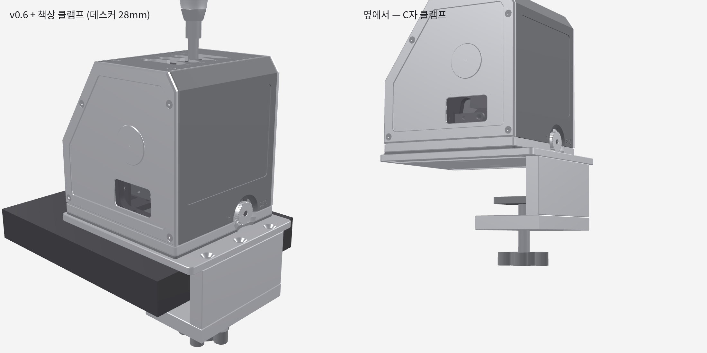

# LSK H/SEQ 쉬프터 v0.6 — 면 분할 블록 외장 / 설계 문서

> 제작: **Sunggwan** · 2026-11-27

v0.4 메커니즘(모듈 M1~M9, CNC 6061, RP2040 + MT6701)은 그대로 두고, v0.5의 곡면 셸을 **샌드위치 구조의 면 분할 블록**으로 바꾼 버전.
크기 **130 × 118.5 × 202mm** (모드 노브 돌출 없음), 몸체 높이 133mm. 부품 예상가 **쉬프터 본체 약 14.26만원 + 책상 클램프 1.5만원 = 약 15.76만원** (`src/BOM.csv` — 배송비·공구 제외, 필라멘트 보유 재고, 아노다이징 안 함). 6061 판·블록은 **평균가 추정** (kg당 약 2만원 = 국내 소량 재단 판매가 kg당 약 1만~2.7만원의 중간값).

> 2026-11-27 보완 (디자인 확정 후): 출력 경계 섀도우 갭 1.2, 슬리브 M3 무두볼트 구멍, 내부 부트 재단 패턴(M11-03), 앞면 `H`/`SEQ` 각인 5.5·깊이 0.5, 게이트 볼트 비대칭은 그대로 두기로 결정. 가공 도면 `docs/dxf/v0.6/` 15장.

## 0. v0.5 → v0.6 핵심 변경
| | v0.5 | **v0.6** |
|---|---|---|
| 외장 | ABS 곡면 셸 한 덩어리 (로프트) | **6061 사이드 패널 ×2 + 앞·뒤 커버(출력) + 게이트 플레이트** 샌드위치 |
| 실루엣 | 둥근 덩어리, 베이스 테두리 3mm 돌출 | 직선 + 앞뒤 평행 경사면(수직 대비 34°), 베이스와 수직 일직선 |
| 파츠 경계 | 없음 | **섀도우 갭** — 출력 경계 1.2 (패널–커버 턱, 게이트–커버), 금속 경계 1.0 (몸체–베이스 홈, 게이트–패널) |
| 측면 | 타원 창 60×30 / 42×20 | 10mm 프레임 + 0.8mm 오목 필드 + **Ø30 피벗 메달리온**, −Y 창 40×22 + 스모크 아크릴 |
| 게이트 | 3t, 셸 뚜껑 | **4t 독립 플레이트, 매립 + 접시머리 M3 ×4 노출**, 번호 운전석 방향 |
| 노브 | 물방울 Ø35 | **슬림 티어드롭 Ø30.8 + M12×1.25** (시판 노브 호환), Ø12 슬리브 + 테이퍼 록너트 |
| 모드 노브 | 앞쪽 10mm 돌출 | **앞면과 같은 높이, R22 손가락 디시 안에 4mm 노출**, `H · SEQ` 각인 |
| 방진 | 없음 (게이트 아래 노출) | **내부 부트** (게이트 아래 프레임 + 레버 칼라) |
| USB-C | 뒤 오른쪽 | **뒤 중앙 최하단**, 1mm 배선 가이드 홈 |
| 바닥 | 평판 | 실리콘 패드 포켓 1mm ×4, M6 구멍 개방 |
| 색 | 다크 그레이 + 생알루미늄 + 오렌지 | **그래파이트 한 색, 광택 차이만** |

## 1. 외장 구성 (M10, M11)
| 부품 | 형상 | 제작 |
|---|---|---|
| **사이드 패널 −Y** | 실루엣 전체, 3t. 바깥 테두리 C1.2, 10mm 프레임 / 0.8 오목 필드(모서리 R3) / Ø30 메달리온(피벗 축 중심, 가운데 Ø2 표시). 필드·메달리온 테두리 C0.5 (가공면 노출). 창 40×22 R3 + C0.4, 안쪽 아크릴 자리 1.2 깊이 | 6061 CNC, 무처리 · 블라스트 후 챔퍼만 재가공 (아노다이징 안 함) |
| **사이드 패널 +Y** | 같은 구성, 창 대신 Ø6 렌치 구멍 (7·R 예압 나사 접근, C0.5) | 6061 CNC |
| **앞 커버** | 앞벽 3t + 경사면 + 윗면 띠 3mm. 오목 필드 0.8 (z −38 위), 모드 노브 디시 R22·깊이 6.5, `H` `SEQ` 각인 글자 5.5·깊이 0.5 (디시 밖 Y −7.5 / 37) | ABS/PETG 출력, 무광 |
| **뒤 커버** | 뒷벽 + 큰 경사면 + 윗면 띠. 뒷면 오목 필드 + `SUNGGWAN` 0.3 각인 | ABS/PETG 출력, 무광 |
| **스모크 창** | 45.6 × 27.6 R3, 1.2t | 스모크 아크릴 또는 PC (구매, 접착) |
| **M11 부트 프레임** | 게이트 개구부 + 1.5mm를 두른 3t 사각 링, 게이트 아래 M3 ×4 (게이트 막힌 탭 3mm) | 출력 |
| **M11 레버 칼라** | Ø14 × 6, 레버 28~34mm 위치 | 출력 |
| **M11-03 부트** | 프레임과 칼라 사이 천 (라이크라/얇은 가죽) 또는 TPU 0.8. 재단 패턴 `CAD/v0.6/buy/M11-03_boot_pattern` (A4 1:1, `src/boot_pattern.py`) | 구매·재단 |

### 조립·체결
- 커버 → 베이스: 수직 보스 4개 (앞 (39, −40)(39, 32), 뒤 (−77, −10)(−77, 39)), M3 인서트, 베이스 아래에서 볼트 (바닥 커버로 가려짐).
- 패널 → 커버: 패널마다 접시머리 M3 ×4, 가장자리에서 5.5mm (앞 아래·앞 위·뒤 아래·뒤 경사면). 커버 안쪽 Y축 보스에 인서트.
- 게이트 → 타워 윗변: 접시머리 M3 ×4 노출, 패턴 X −29 / 28 (X 대칭).
- 조립 순서: v0.4 1~6단계 → 부트 칼라를 레버에 → 부트 + 프레임을 게이트 아래에 → 앞·뒤 커버 → 게이트 → 사이드 패널 → 슬리브·록너트·노브.

## 2. 섀도우 갭·모서리 규칙
- 갭: 패널–커버 경계 1.2 × 1.2 (커버 가장자리 턱), 게이트–커버 1.2 — 출력 부품은 치수 편차가 커서 1.2. 몸체–베이스 1 × 1 (베이스 윗변 홈), 게이트–패널 1.0 — 금속끼리.
- 챔퍼: 패널 바깥 C1.2 / 베이스 바닥 C0.8 / 게이트 테두리·슬롯 C0.6 / 필드 테두리 C0.5 / 창·노브 C0.4. 아노다이징은 안 함 (11-27 결정) → 금속 부품은 무처리 알루미늄, 비드 블라스트 후 챔퍼만 다시 깎아 가공면 노출 (무광/광택 대비).
- 반경: 평면 모서리 R2.5 (베이스), 필드·창 R3, 게이트 모서리 R1.5.

## 3. 레버·노브
| 부품 | 치수 |
|---|---|
| 레버 | Ø8 경화 샤프트, 길이 3~104 (v0.5 117에서 자름) |
| 슬리브 | Ø12 × 36 (레버 72~108), 구멍 Ø8 N7 (가벼운 압입) + 고정제, 윗부분 M12×1.25-6g (85~108). 뒤쪽(−X) M3 탭 1개 (레버 88 = 슬리브 아래에서 16), 무두볼트는 록너트에 가려짐. SUS303 권장 |
| 록너트 | 원뿔 Ø14.4 → Ø19.6, 높이 9, 렌치 면 17mm |
| 노브 | 94~126, 최대 Ø30.8, 목 Ø19.6, 윗면 Ø22.4 + H패턴 각인, 목 부분 V홈 1줄. 암나사 M12×1.25 깊이 14 |
- 손 잡는 중심은 v0.5와 같은 약 110mm → 캠 힘 곡선 그대로.
- 시판 노브 허용 무게: **약 500g까지** (11-27 결정). 추정 영향 — 500g 노브의 14° 중력 토크는 노브 기준 약 1.2N (중립 디텐트 7N 대비 작음), 관성 약 0.006kg·m². 손맛 프로토타입에서 30~500g으로 바꿔 가며 확인.

## 4. v0.4 기구 영향 확인
| 항목 | 변경 | 기구 영향 |
|---|---|---|
| 게이트 두께 | 3t → 4t, 중심 55 유지 (53~57) | 타워 윗변 53.5 → 53 (0.5mm 깎음), 개구부는 4t 기준으로 다시 계산 |
| 게이트 탭 | 타워 윗변 X −30/22 → −29/28 | 구멍 위치만 |
| 레버 | 길이 117 → 104 | 허브 고정부(3~19) 동일 |
| 모드 축 | 53 → 45.5, 노브 Ø19 × 4.5 (x 41.5~46) | 편심·잠금 동일 |
| 베이스 | 외곽 130 × 118.5, RP2040 포켓·USB-C를 뒤 중앙으로, 연결 홈 추가 | 위쪽 기구 구멍 동일 |
| 사이드 패널 | 타워 직결 대신 커버에 체결 | −Y 센서 캡(바깥 8mm), +Y 스프링 카트리지(바깥 13mm)가 타워보다 튀어나와서 |
- 게이트 볼트 Y 위치(−53/31)는 타워 위치로 정해져서 게이트 중심(−8.25)과 2.75mm 어긋남 → 가장자리까지 10.5 / 16mm. **그대로 두기로 결정 (11-27)** — 기구·타워 변경 없음, 슬롯 패턴이 원래 비대칭이라 잘 드러나지 않음.

### 방진판 → 내부 부트로 바꾼 이유
게이트 아래 판을 레버와 같이 미는 방식은 판 크기가 (개구부 + 레버 이동량 × 2)가 됨.
허브가 지나가는 높이(z 21) 바로 위 z 22에서 계산해도 Y 방향 약 75mm가 필요하고, 범위가 +Y 쪽으로 치우쳐 y ≈ 33까지 감 → +Y 타워 안쪽 면(y 28)을 넘어서 안 들어감.
부트는 내부를 완전히 가리고 기구와 닿지 않음. 천의 저항은 작을 것으로 추정 → 손맛 프로토타입에서 확인.

### 부트 재단 패턴 (M11-03)
- 프레임 안쪽 둘레(41.8 × 61, z 50)에서 레버 칼라 윗끝(레버 34mm, Ø14)까지의 선직면을 삼각형으로 펼침.
- 모든 레버 자세(H 전 기어 ±14.5°, 중립 이동, 시퀀셜 ±8°)에서 필요한 길이 31~51mm에 여유 5%를 더함. 남는 길이는 부드러운 주름으로 처짐 (라이크라 기준, TPU면 여유 10% 권장).
- 접착 여유: 프레임 쪽 8 (프레임 아래면에 접착), 칼라 쪽 6 (감아서 접착 또는 케이블 타이), 솔기 겹침 6 (뒤 −X, 안 보이는 쪽). 패턴 78 × 136mm, A4 1:1 인쇄 (50mm 확인 사각형 포함).
- 처진 천이 허브(z 약 21)에 닿는지는 프로토타입에서 확인 — 닿으면 여유를 줄이고 신축성 천 사용.

## 5. 검증
- 간섭 검사: 외장 포함 모든 부품 쌍 × 41개 자세 (H 모든 기어 ±3/7/11/14°, 중립 게이트 이동, 시퀀셜 ±4/7.8°) → 결과는 §5.1
- 부트(천)는 유연 부품이라 검사에서 제외, 프레임·칼라는 포함.
- 렌더: `CAD/v0.6/images/` — `v06_vs_v05_hero.png`, `v06_vs_v05_side.png`, `v06_vs_v05_front.png`, `v06_details.png`, `v06_rear.png`

### 5.1 간섭 검사 결과
**41개 자세, 간섭 0** (외장 포함 전 부품 쌍, `check.py` 419초). 부트 천은 제외, 부트 프레임·칼라·볼트 머리 포함.
- 11-27 소스 복원 후 재검사 0 (95초), 보완(갭 1.2·슬리브 구멍·각인) 후 재검사 0 (93초).

## 6. 제작 메모
- 사이드 패널: 3t 판에서 외곽·창·구멍 → 바깥면 필드 0.8 포켓 → 챔퍼. 블라스트 후 챔퍼만 다시 깎으면 밝은 테두리 (아노다이징 없음).
- 커버: 옆으로 눕혀서 출력 (단면 = 레이어 모양, 서포트는 수직 보스만). 0.12~0.16 레이어, 바깥면 사포 400 → 무광 클리어.
- 게이트 4t: 슬롯 C0.6, 각인 0.4, 아래면 M3 막힌 탭 ×4 (부트 프레임).
- 바닥 패드: 26 × 14 / 24 × 14 실리콘 1.5t (포켓 1.0 → 0.5 돌출).
- 앞면 `H`/`SEQ` 각인: 몸체와 같은 색이라 렌더에서는 5.5로 키워도 그림자로만 보임 → 실물은 각인 안을 밝은 회색 도료로 채운 뒤 표면을 닦아내는 방식 권장 (게이트 각인은 블라스트 후 윗면 페이스컷으로 대비가 생김).

## 7. 나머지
가공 목록·조립·튜닝·리스크는 v0.4 문서와 같음 (모듈 M1~M9). 소스: `shifter/src/cad.py` 끝부분 `v0.6` 섹션, 렌더 `src/render_v06.py`, 산출물 `shifter/CAD/v0.6/`.

품번: M7-01 게이트 4t · M8-01 노브 · M8-02 슬리브 · M8-03 록너트 · M10-01/02 사이드 패널 −Y/+Y · M10-03/04 앞·뒤 커버 · M10-05 스모크 창 · M11-01 부트 프레임 · M11-02 레버 칼라.

품번 추가: M11-03 부트 재단 패턴.

도면: `docs/dxf/v0.6/` 15장 ([INDEX](../dxf/v0.6/INDEX.md)). 양식은 PR #1 rev D (실무 도면 양식: 표제란·공차표·거칠기표·개정란·구멍 지시선). 바뀐 부품 M1-01 베이스·M2-01/02 타워·M7-01 게이트 **rev E**, 새 부품 M10-01/02 사이드 패널·M8-02 슬리브·M8-03 록너트 rev A. 나머지(M3·M5·M6)는 v0.5 rev D와 형상 같음 (M3-01/02는 주서 블라스트 입도 누락만 고쳐 rev E). 큰 판재 6장(M1-01·M2-01/02·M7-01 → rev F, M10-01/02 → rev B)은 **A3 가로 1:1** (A4에서는 패널 1:5, 나머지 1:2였음). **v0.5 도면으로 M1-01·M2·M7-01을 가공하면 안 됨.**

## 8. 결정 (11-27, 렌더 검토)
- 외장 디자인 **확정** (메달리온·앞면 필드·노브 그대로).
- 장착: 베이스 M6 40mm 패턴 + **어댑터 판** (프로파일용 / 책상 클램프용 따로).
- PC 설정 소프트웨어: **웹(WebSerial) + CLI**, 같은 시리얼 프로토콜 → 펌웨어 USB HID + CDC 복합 장치로 변경 필요.

## 9. 결정 (11-27) — 아노다이징 안 함 · 판재 평균가 · 데스커 책상 클램프
- **아노다이징 안 함**: 금속 부품 전부 무처리 (비드 블라스트 #150 선택, 챔퍼 재가공으로 가공면 노출). 캠·게이트·SEQ 잠금은 표면 경화가 없으므로 그리스 + 마모 관찰, 닳으면 그 부품만 재가공. 도면 15장 REMARKS = `무처리 · 블라스트` (rev 한 단계씩 올림). 외관: 그래파이트 한 색 → **은색 알루미늄 패널 + 어두운 출력 커버** 투톤.
- **판재값**: 평균가 추정 kg당 약 2만원 → 기구 6061 약 1.57kg 32,000원, 4t 게이트 3,000원, 클램프 약 0.66kg 13,000원.
- **책상**: 데스커 검정 나무 책상 (상판 약 28mm, MDF 계열) → **M12 책상 클램프**.

### M12 책상 클램프 (C자 클램프)
| 품번 | 부품 | 소재 | 크기 |
|---|---|---|---|
| M12-01 | 윗판 | 6061 6t | 151 × 124.5 — 바닥 커버 아래, 베이스 M6 탭 4곳에 M6×12 접시머리 (아래에서) |
| M12-02 | 기둥 | 6061 12t | 12 × 100 × 48 — 책상 앞 모서리에 닿음, 윗판·턱과 M5×16 접시머리 3개씩 |
| M12-03 | 아래 턱 | 6061 12t | 60 × 100 — 책상 밑으로 47 들어감, M10 관통 탭 |
| M12-04 | 누름 패드 | PETG 출력 | 44 × 36 × 6, 볼트 끝 자리 Ø10.8 (살짝 기울어 책상 밑면에 맞춰짐) |
| M12-05 | 손잡이 | PETG 출력 | 별 모양 Ø46, M10 볼트 머리(17mm) 압입 + 에폭시 |
| M12-06 | 조임 볼트 | 구매 | M10 × 50 육각볼트 |

- 방향: 모드 노브 면(+X)이 운전석 쪽 → 기둥이 책상 앞 모서리에 걸림. 쉬프터는 책상 위에 그대로 올라앉고 클램프 윗판은 바닥 커버 밑에 숨음.
- 책상 두께 **15~38mm** 사용 가능 (벌림 48 − 패드 6 − 실리콘 2 − 윗판 실리콘 1). 데스커 28mm에서 볼트 머리는 턱 아래 약 24.
- 책상 보호: 윗판 밑면 실리콘 띠 129×18 ×2, 기둥 안쪽 88×24, 패드 위 44×36 — 전부 2t 실리콘판(1.0 포켓)에서 잘라 씀 → 검정 상판 긁힘 방지. 클램프 쓸 때는 바닥 커버의 논슬립 패드는 빼고 조립 (윗판에 바로 닿게).
- 책상 밑 여유: 앞 모서리에서 **안쪽 55mm 이상** 프레임·서랍이 없어야 함 (턱 47 + 손잡이). 데스커 모델마다 다르니 설치 전 확인.
- 간섭 검사: 책상 두께 15 / 28 / 38mm 모두 0 (`check.py`), 쉬프터 41개 자세 0.
- 도면 3장 (M12-01 A3, M12-02·03 A4) rev A. 렌더 `src/render_clamp.py` →

